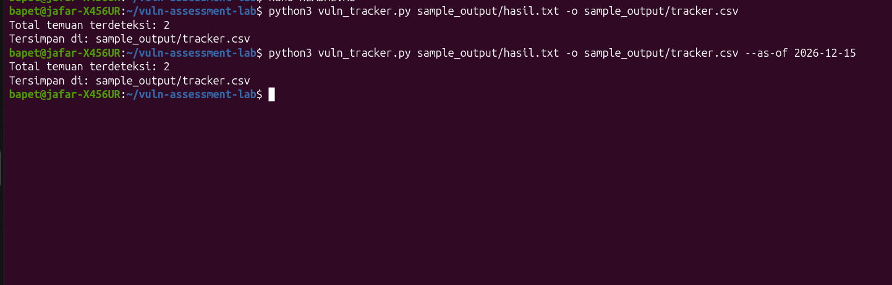

# Infrastructure Vulnerability Assessment & SLA Tracking Simulation

## 1. Tujuan
Membangun simulasi lab *Vulnerability Management* mandiri untuk mempelajari proses pemindaian aset, inventarisasi celah keamanan (CVE), klasifikasi severity berbasis CVSS, serta pemantauan SLA remediasi dan analisis *False Positive*.

## 2. Topologi Lab
- **Scanner / OS:** Ubuntu Linux (x86_64)
- **Target Scan:** Localhost (127.0.0.1) / Layanan aktif (CUPS, dll.)
- **Tools Utama:** Nmap (Nmap Scripting Engine / vulners), Python 3 (Custom Vulnerability & SLA Tracker)

## 3. Langkah Menjalankan
1. Jalankan pemindaian kerentanan Nmap:
   ```bash
   sudo nmap -sV --script vulners -T4 -oN sample_output/hasil.txt localhost

## 4. Screenshot Hasil Simulasi


